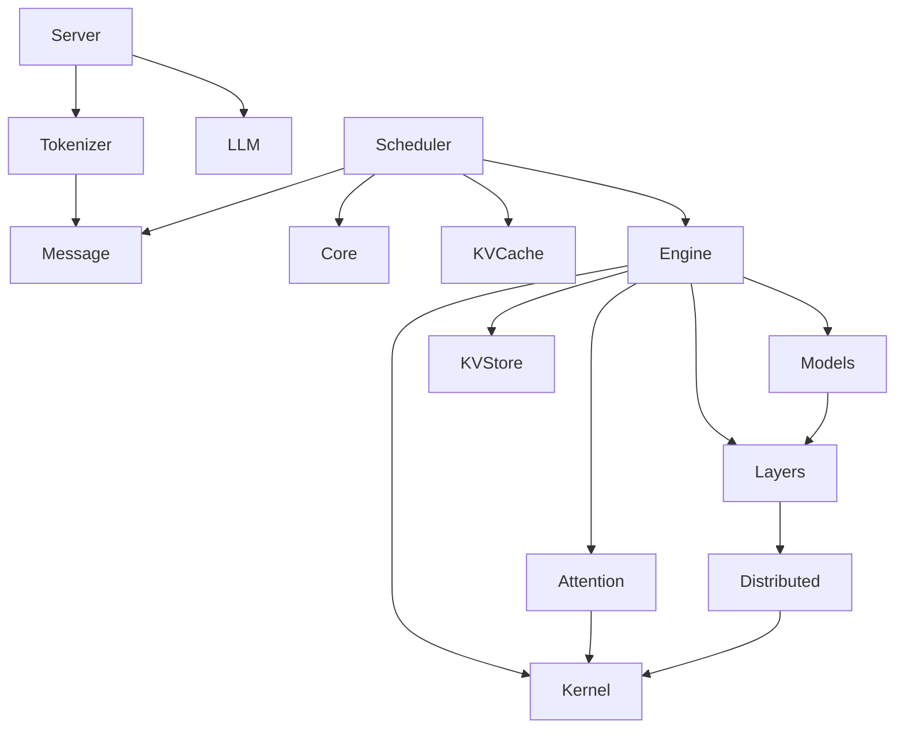

# 仓库与模块地图

本页把仓库中的每个源文件映射到职责和推荐章节。路径全部相对 `python/minisgl/`，除非另有说明。

## 依赖方向

依赖应总体从“传输/入口”流向“调度/执行”再流向“层/kernel”。低层模块不应反向依赖 server。通过注册表或工厂加载可选 backend，可以避免 import 时导入所有框架。

## 根模块

| 模块 | 职责 | 章节 |
|---|---|---|
| `__init__.py` | 教学包版本与脚手架标记 | 全局 |
| `__main__.py` | `python -m minisgl` CLI 入口 | 服务 |
| `core.py` | `Req`、`Batch`、`Context`、采样参数 | Core |
| `env.py` | 环境变量解析与全局配置 | 环境 |
| `shell.py` | 交互式聊天入口 | 服务 |

## `attention/`

| 模块 | 职责 | 章节 |
|---|---|---|
| `__init__.py` | attention backend 注册与工厂 | Kernel |
| `base.py` | backend 和 metadata 抽象契约 | Kernel |
| `utils.py` | attention 通用辅助 | Kernel |
| `fa.py` | FlashAttention backend | Kernel |
| `fi.py` | FlashInfer backend | Kernel |
| `trtllm.py` | TensorRT-LLM backend | Kernel |

学习顺序：`base.py` -> CPU reference metadata -> `fa.py`/`fi.py` -> hybrid -> 厂商约束。

## `benchmark/`

| 模块 | 职责 | 章节 |
|---|---|---|
| `client.py` | 在线 client 封装 | 性能 |
| `perf.py` | 计时、显存和 kernel 性能比较 | 性能 |

顶层 `benchmark/offline/bench.py`、`bench_wildchat.py` 和 `benchmark/online/bench.py` 系列是 workload 脚手架。

## `distributed/`

| 模块 | 职责 | 章节 |
|---|---|---|
| `__init__.py` | 分布式 API 导出 | 分布式 |
| `info.py` | rank、world size、group 信息 | 分布式 |
| `impl.py` | communicator、初始化/销毁、PyNCCL 接入 | 分布式 |

先完成“无通信的单 rank 模拟”，再启动真实多进程。不要用单进程对象模拟来替代 collective 测试。

## `engine/`

| 模块 | 职责 | 章节 |
|---|---|---|
| `__init__.py` | Engine 公共导出 | Engine |
| `config.py` | 引擎配置 | Engine |
| `engine.py` | forward、资源装配与生命周期 | Engine |
| `graph.py` | CUDA Graph capture/replay 与 padding | Engine |
| `sample.py` | logits 采样和 batch 采样参数 | Engine |

推荐顺序：config -> sampling -> engine forward -> graph。

## `kernel/`

### Python 与绑定

| 模块 | 职责 | 章节 |
|---|---|---|
| `__init__.py` | kernel Python API | Kernel |
| `__main__.py` | kernel 测试/编译入口 | Kernel |
| `utils.py` | JIT 编译、模块加载和辅助 | Kernel |
| `index.py` | embedding/index 选择 kernel | Kernel |
| `store.py` | KV cache 写入 kernel | Kernel |
| `tensor.py` | native tensor 测试入口 | Kernel |
| `radix.py` | Radix key 快速比较 | Kernel |
| `pynccl.py` | PyNCCL communicator | 分布式 |
| `moe_impl.py` | MoE 聚合 kernel 入口 | 模型 / Kernel |
| `triton/fused_moe.py` | Triton fused MoE | 模型 / Kernel |

### 原生源文件

| 文件 | 职责 | 章节 |
|---|---|---|
| `csrc/jit/index.cu` | index/embedding kernel | Kernel |
| `csrc/jit/store.cu` | KV store kernel | Kernel |
| `csrc/src/pynccl.cu` | NCCL C++ 绑定 | 分布式 |
| `csrc/src/radix.cpp` | Radix compare 绑定 | Kernel |
| `csrc/src/tensor.cpp` | tensor 辅助绑定 | Kernel |
| `csrc/include/minisgl/nccl227.h` | NCCL 兼容声明 | 分布式 |
| `csrc/include/minisgl/tensor.h` | tensor 原生辅助接口 | Kernel |
| `csrc/include/minisgl/utils.h` | C++ 通用工具 | Kernel |
| `csrc/include/minisgl/utils.cuh` | CUDA 通用工具 | Kernel |
| `csrc/include/minisgl/warp.cuh` | warp 原语 | Kernel |

原生代码不要只看编译是否成功。必须为每个暴露 API 增加 shape、越界和 reference parity 测试。

## `kvcache/`

| 模块 | 职责 | 章节 |
|---|---|---|
| `__init__.py` | cache pool/prefix cache 工厂 | KV Cache |
| `base.py` | cache handle、match/insert、lock/evict 契约 | KV Cache |
| `mha_pool.py` | 分页 K/V tensor 物理存储 | KV Cache |
| `naive_cache.py` | 最小前缀缓存实现 | KV Cache |
| `radix_cache.py` | 压缩 Radix Tree 前缀复用 | KV Cache |

先实现 `base.py` 的契约，再保证 `naive_cache.py` 正确，最后用相同测试套件约束 Radix 实现。

## `layers/`

| 模块 | 职责 | 章节 |
|---|---|---|
| `__init__.py` | 层 API 导出 | 模型 |
| `base.py` | `BaseOP`、无状态算子和算子列表 | 模型 |
| `activation.py` | SiLU/GELU gated activation | 模型 |
| `attention.py` | attention 层装配 | 模型 |
| `embedding.py` | vocab-parallel embedding 与 LM head | 模型 |
| `linear.py` | 复制、行并行、列并行和 fused projection | 模型 |
| `moe.py` | MoE 层装配 | 模型 |
| `norm.py` | RMSNorm 与 residual fusion | 模型 |
| `rotary.py` | RoPE 和设备相关旋转表 | 模型 |

每个算子至少有一个无 TP 参考测试，再增加 TP=2 等价测试。

## `llm/`

| 模块 | 职责 | 章节 |
|---|---|---|
| `__init__.py` | Python LLM API 导出 | 服务 |
| `llm.py` | 启动、生成、流式接口与进程生命周期 | 服务 |

`LLM` 不应直接暴露 scheduler 内部对象。它是教学系统的用户级门面。

## `message/`

| 模块 | 职责 | 章节 |
|---|---|---|
| `__init__.py` | 消息类型统一导出 | Core |
| `frontend.py` | API 到 tokenizer 的回复消息 | Core |
| `tokenizer.py` | tokenize、abort、detokenize 消息 | Core |
| `backend.py` | scheduler/engine 控制消息 | Core |
| `utils.py` | 白名单类型序列化和反序列化 | Core |

消息层应尽量不依赖模型执行层，测试可以在 CPU 独立完成。

## `models/`

| 模块 | 职责 | 章节 |
|---|---|---|
| `__init__.py` | 模型工厂与公共 API | 模型 |
| `base.py` | 模型抽象接口 | 模型 |
| `config.py` | 模型与 RoPE 配置 | 模型 |
| `register.py` | architecture 注册表 | 模型 |
| `utils.py` | 模型通用构造辅助 | 模型 |
| `weight.py` | checkpoint 加载、映射和 TP 切分 | 模型 |
| `llama.py` | Llama 结构 | 模型 |
| `mistral.py` | Mistral 结构 | 模型 |
| `qwen2.py` | Qwen2 结构 | 模型 |
| `qwen3.py` | Qwen3 dense 结构 | 模型 |
| `qwen3_moe.py` | Qwen3 MoE 结构 | 模型 |

优先提取共享 block，再实现模型差异。每个模型保存最小 config 与 golden logits。

## `moe/`

| 模块 | 职责 | 章节 |
|---|---|---|
| `__init__.py` | MoE backend 注册与工厂 | 模型 |
| `base.py` | MoE backend 契约 | 模型 |
| `fused.py` | fused dispatch/GEMM/combine 路径 | 模型 / Kernel |

先实现 deterministic reference，再接 Triton 或原生 fused 路径。

## `scheduler/`

| 模块 | 职责 | 章节 |
|---|---|---|
| `__init__.py` | Scheduler 公共导出 | 调度 |
| `config.py` | batch、token budget、page、cache 配置 | 调度 |
| `io.py` | scheduler 消息收发与多 rank 同步 | 调度 |
| `utils.py` | `PendingReq` 等队列状态 | 调度 |
| `table.py` | table slot 与 token pool | 调度 |
| `cache.py` | free pages、page table、prefix cache 协调 | KV Cache / 调度 |
| `prefill.py` | 等待队列、prefill 与 chunked prefill | 调度 |
| `decode.py` | 运行请求集合与 decode batch | 调度 |
| `scheduler.py` | 单轮主循环和 overlap scheduling | 调度 |

这是课程的核心章节。建议为 `table.py`、`decode.py`、`prefill.py` 分别建立独立状态图。

## `server/`

| 模块 | 职责 | 章节 |
|---|---|---|
| `__init__.py` | server 入口导出 | 服务 |
| `args.py` | CLI 参数与配置映射 | 服务 |
| `launch.py` | 启动和回收各 worker | 服务 |
| `api_server.py` | FastAPI 路由、OpenAI schema、stream | 服务 |

API 层先可注入 fake tokenizer/scheduler 做无模型测试，再接真实进程。

## `tokenizer/`

| 模块 | 职责 | 章节 |
|---|---|---|
| `__init__.py` | tokenizer worker 导出 | 服务 |
| `server.py` | tokenize/detokenize worker 循环 | 服务 |
| `tokenize.py` | 文本到 token 消息 | 服务 |
| `detokenize.py` | 增量 token 到文本 | 服务 |

增量 detokenize 必须覆盖 UTF-8 多字节字符和特殊 token。

## `utils/`

| 模块 | 职责 | 章节 |
|---|---|---|
| `__init__.py` | 工具 API 导出 | 基础 |
| `misc.py` | 对齐、除法、main guard 与 UNSET | 基础 |
| `registry.py` | 名称到工厂/类的注册表 | 基础 |
| `logger.py` | rank-aware 日志 | 基础 |
| `arch.py` | GPU 架构能力判断 | 环境 |
| `hf.py` | Hugging Face 配置、权重、tokenizer | 模型 |
| `torch_utils.py` | dtype、nvtx 辅助 | 基础 |
| `mp.py` | ZMQ 队列封装 | 服务 / 分布式 |

先实现纯 Python 工具，因为它们决定调度和 cache 测试的边界语义。

## 全仓完成顺序

1. `core.py`、`utils/misc.py`、`utils/registry.py`；
2. `message/*`；
3. `kvcache/base.py`、`naive_cache.py`；
4. `scheduler/table.py`、`decode.py`；
5. `kvcache/radix_cache.py`、`scheduler/cache.py`；
6. `scheduler/prefill.py`、`scheduler/scheduler.py`；
7. `layers/*` 与 `models/*`；
8. `engine/*`；
9. `server/*`、`tokenizer/*`、`llm/*`；
10. `attention/*`、`kernel/*`、`distributed/*`；
11. `benchmark/*` 与性能报告。

如果时间有限，先完成 1 到 9 的 CPU/单卡路径；高级模块即使未实现，也应能解释其边界和验收方法。
